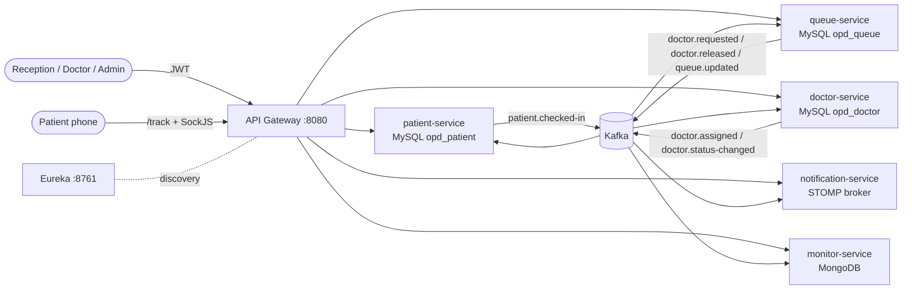

# Real-Time OPD Queue Orchestration & Patient Notification System

Five Spring Boot microservices plus an API gateway and Eureka. They coordinate a hospital
outpatient queue through Kafka events. Patients watch their live position over WebSocket.



## Services

| Service | Port | Owns | Responsibility |
|---|---|---|---|
| api-gateway | 8080 | – | Routing (`lb://` via Eureka), JWT validation, CORS, SockJS/WebSocket proxy |
| eureka-server | 8761 | – | Service registry |
| patient-service | 8081 | MySQL `opd_patient` | Staff login (issues JWTs), check-in, daily token numbers |
| queue-service | 8082 | MySQL `opd_queue` | In-memory per-department queue engine, ordering strategies, dispatch |
| doctor-service | 8083 | MySQL `opd_doctor` | Doctor registry, atomic doctor assignment |
| monitor-service | 8084 | MongoDB `hospital_monitor` | Event log, queue snapshots, doctor status, dead letters, dashboard |
| notification-service | 8085 | – | Live positions over STOMP/SockJS |

Each service has its own schema and its own database user. No service reads another service's database.

## Event flow

| Topic | Producer | Consumers | Key |
|---|---|---|---|
| `patient.checked-in` | patient-service | queue-service, monitor-service | departmentId |
| `queue.updated` (compacted) | queue-service | notification-service, monitor-service | departmentId |
| `doctor.requested` | queue-service | doctor-service, monitor-service | departmentId |
| `doctor.assigned` | doctor-service | queue-service, patient-service, monitor-service | departmentId |
| `doctor.released` | queue-service | doctor-service, patient-service, monitor-service | departmentId |
| `doctor.status-changed` | doctor-service | monitor-service | departmentId |

A visit goes through these steps:

1. Reception calls `POST /api/patients/checkin`. patient-service locks the department row, allocates the next
   token (it resets daily), and stores the patient plus a `patient.checked-in` outbox row in one transaction.
2. queue-service adds the patient to the department's queue. If no doctor request is outstanding, it calls the
   head of the queue (`AWAITING_DOCTOR`) and emits `doctor.requested`.
3. doctor-service reserves a doctor atomically, or keeps the request pending until one becomes free, then emits
   `doctor.assigned`.
4. queue-service moves the patient to `IN_CONSULTATION` and calls the next patient. Every committed change emits
   a versioned `queue.updated` snapshot, which notification-service pushes to each patient's screen.
5. The doctor finishes (`PUT /api/queue/patients/{id}/done`). `doctor.released` frees the doctor, who immediately
   takes the next pending request.

## Concurrency and consistency design

| Problem | Mechanism | Where |
|---|---|---|
| Duplicate tokens on concurrent check-in | `SELECT … FOR UPDATE` on the department row (3s lock timeout), plus a unique key on (department, date, sequence) | `DepartmentRepository`, `PatientTransactions#checkIn` |
| Lock timeout or deadlock | `@Retryable` facade around a separate `@Transactional` bean, so every retry gets a fresh transaction | `PatientServiceImpl` |
| Same doctor assigned twice | `SELECT … LIMIT 1 FOR UPDATE SKIP LOCKED` on doctor and request, both flipped in one transaction (atomic find-and-assign) | `AssignmentService#matchDepartment` |
| Lost wake-up between SKIP LOCKED matchers | Reconciler re-runs matching every 2s for departments with pending requests | `AssignmentReconciler` |
| Manual status change vs. assignment | `@Version` optimistic lock + `@Retryable` (retry re-reads state) | `Doctor`, `DoctorServiceImpl#updateStatus` |
| Status events arriving out of order | Forward-only state machine; stale transitions are ignored | `PatientStatus` |
| Concurrent queue mutations | Per-department `ReentrantLock` in a `ConcurrentHashMap` (no global lock), held across the DB transaction | `QueueManager`, `QueueServiceImpl#mutate` |
| Memory/DB divergence | Immutable snapshot installed in memory only after commit (copy-on-write, lock-free reads) | `DepartmentSnapshot`, `QueueServiceImpl#mutate` |
| Multiple queue-service instances | Department row lock in MySQL + `state_version`; a stale instance reloads from MySQL | `QueueDepartment`, `QueueServiceImpl#currentSnapshot` |
| DB write + Kafka publish (dual write) | Transactional outbox; relay publishes in id order with `SKIP LOCKED` | `outbox/*` in patient, queue and doctor services |
| Duplicate deliveries | Idempotent consumers: unique keys, request ids, state checks, Mongo ids = event ids | every consumer |
| Stale WebSocket positions | Versioned snapshots; notification-service and the page drop older versions; current state sent on subscribe | `NotificationServiceImpl`, `patient-queue.html` |

### Retries and dead letters

Consumers use `@RetryableTopic` with exponential backoff (1s → 2s → 4s, 4 attempts). Each service has its own
suffix (`-queue-retry`, `-doctor-dlt`, …), so one service's failures never land in another's retry topics.
Malformed payloads go straight to the DLT, because conversion errors aren't retryable.

monitor-service subscribes to `.*-dlt` and stores every dead letter in MongoDB. An admin can list them and
replay them (`POST /api/monitor/dead-letters/{id}/replay`); every consumer is idempotent, so replaying is safe.
`queue.updated` deliberately uses only short in-place retries in notification-service, because the next
snapshot supersedes a lost one.

### Queue ordering (Strategy + Factory)

`QueuePriorityStrategy` implementations are Spring beans, selected per department by `QueueStrategyFactory`
from configuration. An unknown name fails at startup.

```properties
queue.strategy.default-strategy=FIFO
queue.strategy.departments.EMERGENCY=PRIORITY         # CRITICAL > URGENT > NORMAL, then arrival
queue.strategy.departments.CARDIOLOGY=AGING_PRIORITY  # priority + minutes waited / 15 (no starvation)
```

## Security

- patient-service issues HS256 JWTs (`POST /api/auth/login`) carrying a `roles` claim: `ADMIN`, `STAFF`, `DOCTOR`.
- The gateway and every service validate the token (signature, expiry, issuer). Endpoints check roles with
  `@PreAuthorize`.
- Patients have no accounts. The check-in response contains a random 128-bit access code; the tracking page
  `/track/{accessCode}` and the WebSocket topic use it. Token numbers are guessable, so they are never used as
  topic names. Clients cannot `SEND` STOMP messages, and pushes contain no patient names.
- All secrets come from the environment (`.env`, git-ignored). In Docker Compose only the gateway is published.

## Running

### Everything in Docker

```bash
cp .env.example .env      # set real values
docker compose up --build # gateway: http://localhost:8080, Eureka: http://localhost:8761
```

### Services from the IDE

Start the infrastructure with `docker compose up mysql mongo kafka zookeeper eureka-server` (MySQL is published
on `localhost:3307`), or use your own. Each service imports `../.env`, so set `MYSQL_PORT` to match. On your own MySQL, create the
schemas and users once with `infra/mysql/init/01-create-databases.sh` (see the header of that script).
Flyway creates the tables; Hibernate only validates them.

### Try it

```bash
TOKEN=$(curl -s localhost:8080/api/auth/login -H 'Content-Type: application/json' \
  -d '{"username":"reception","password":"<STAFF_PASSWORD>"}' | jq -r .accessToken)

curl -s localhost:8080/api/patients/checkin -H "Authorization: Bearer $TOKEN" \
  -H 'Content-Type: application/json' \
  -d '{"name":"Asha","phone":"9876543210","department":"OPD","priority":"NORMAL"}'
# → open http://localhost:8080/track/<accessCode> from the response

curl -s localhost:8080/api/queue/OPD/status -H "Authorization: Bearer $TOKEN"
```

## Tests

```bash
mvn verify   # needs Docker: integration tests use Testcontainers (MySQL 8, Kafka, MongoDB)
```

| Module | What is verified |
|---|---|
| patient-service | 40 concurrent check-ins → tokens 1..40, no duplicates or gaps; daily reset; out-of-order events; optimistic-lock retry; login, 401/403, validation |
| queue-service | duplicates ignored; assigned patient is never re-called; late assignment rejected and doctor released; priority ordering; 100 concurrent events in two departments keep memory equal to MySQL with gap-free versions; stale-instance reload; Kafka consumption; poison pill → DLT |
| doctor-service | 20 concurrent requests on 3 doctors → exactly 3 distinct assignments; idempotent request/release; break/return; optimistic-lock retry; `@Version` rejects stale writes |
| notification-service | Kafka → real STOMP/SockJS client; stale snapshot dropped; current state on subscribe; destination guard |
| monitor-service | idempotent ingestion; doctor status never rolls back; dashboard aggregates; DLT collected and replayed end to end; role checks |
| api-gateway | missing, expired and foreign-key tokens rejected; public paths open |

With Docker Engine 25+, Testcontainers 1.19 needs `-Dapi.version=1.44`; the POMs set this through `docker.api.version`.

## Known limitations and trade-offs

- **One outstanding doctor request per department.** The head of the queue is "called" and committed as next;
  a CRITICAL patient arriving after that waits for the following slot. Assignment rounds are serial per
  department (each takes milliseconds).
- **Single active writer per department.** Correctness across queue-service instances comes from the MySQL row
  lock. Throughput per department is bounded by that lock, which is the intended trade-off for a
  hospital-scale queue.
- **notification-service uses the in-memory simple broker.** Every instance consumes every snapshot (unique
  consumer group per instance), so no broker relay is needed. A full STOMP broker (RabbitMQ) would add
  guaranteed delivery to clients.
- **Wait estimates** are `patients ahead × queue.avg-consultation-minutes`.
- **HS256 shared secret.** Simple to operate; an asymmetric key (RS256 with a JWKS endpoint) would avoid
  sharing the signing key with every service.
